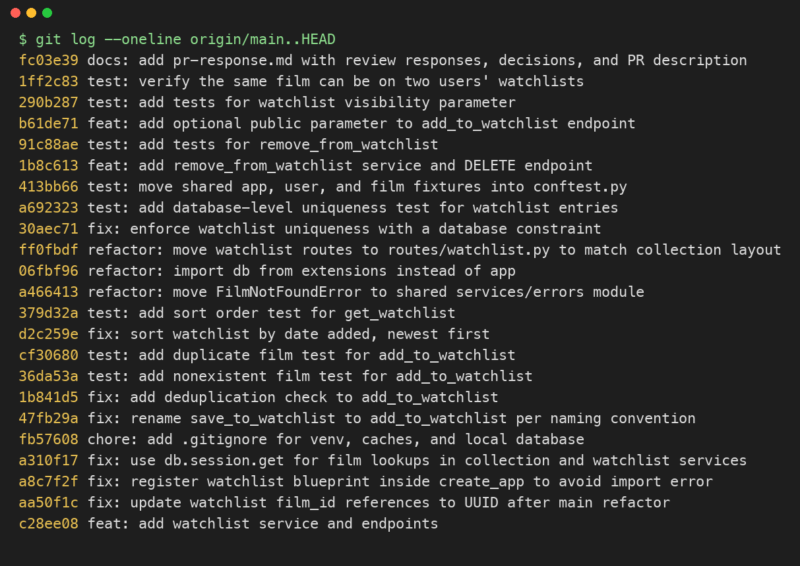

# PR Response Doc — CineLog Watchlist Feature

## AI Usage

- **Orientation and review feedback (first submission).** I read `models.py`, `services/collection_service.py`, and `tests/test_collection.py` before the review comments, and used the existing collection code as the model for the watchlist changes.
- **Resubmission, done with Claude Code (an AI coding agent).** After grading, I had Claude Code read the grader feedback and the project spec, then make the changes the feedback called for. It rebuilt my branch history into conventional commits (splitting the UUID fix into its own `fix:` commit) and moved `FilmNotFoundError` to a neutral `services/errors.py`. It switched `models.py`, `seed.py`, the services, and the tests to import `db` from `extensions.py`, moved the watchlist routes to `routes/watchlist.py`, and added a database uniqueness constraint. It also consolidated the test fixtures into `tests/conftest.py`, wrote the stretch features and their tests, and drafted the new sections of this doc (Comment 2's concurrency note, the stretch sections, and the PR description). I reviewed each change and ran the test suite after every commit.
- **What AI did not write.** The Comment 4 (visibility) and Comment 5 (sort order) arguments are my original responses from the first submission. The only additions are a short "Update" note under each, which records how the stretch work changes the tradeoff I described.

## Comment 1 — Rename
**What I did:** Renamed `save_to_watchlist()` to `add_to_watchlist()` in `services/watchlist_service.py` and updated its import and call in the watchlist route, to match the `verb_to_noun` convention in `CONTRIBUTING.md` (`add_to_collection()`, `remove_from_collection()`, `get_collection()`). Commit: `fix: rename save_to_watchlist to add_to_watchlist per naming convention`.
**How I verified:** `git grep -n save_to_watchlist` across the repo returns nothing, and the full test suite passes.

## Comment 2 — Deduplication
**What I did:** I followed the pattern in `add_to_collection()` in `services/collection_service.py`. That function checks for an existing `CollectionEntry` with the same `user_id` and `film_id`. If it finds one, it raises `AlreadyInCollectionError` without saving anything, and the collection route returns that as a 409 Conflict. I copied the pattern into `add_to_watchlist()`. It now queries for an existing `WatchlistEntry` with the same `user_id` and `film_id` and raises a new `AlreadyInWatchlistError` before creating a duplicate. The watchlist route catches that error and returns 409. Commit: `fix: add deduplication check to add_to_watchlist`.

**Second layer (resubmission):** `CollectionEntry` also has a database-level `UniqueConstraint("user_id", "film_id")`, and `WatchlistEntry` did not. The service check by itself has a race. If two requests for the same film arrive at the same moment, both can run the `existing` query before either commits, and both inserts succeed. I added `UniqueConstraint("user_id", "film_id", name="unique_user_film_watchlist")` to `WatchlistEntry`, so the database rejects the second row. `add_to_watchlist()` now catches the resulting `IntegrityError`, rolls back, and raises the same `AlreadyInWatchlistError`, so the caller still gets a 409 instead of a 500. Commit: `fix: enforce watchlist uniqueness with a database constraint`. One caveat: there are no migrations in this project, so a local `instance/cinelog.db` created before this change won't get the constraint until it is deleted and recreated (`python seed.py`).

**How I verified:** By hand, adding the same film twice with curl returned 201 the first time and 409 the second. I also added automated tests so this doesn't depend on manual checking:
- `test_add_to_watchlist_duplicate_raises` mirrors `test_add_to_collection_duplicate_raises`. It asserts that the second add raises `AlreadyInWatchlistError` and that exactly one row exists. Commit: `test: add duplicate film test for add_to_watchlist`.
- `test_watchlist_unique_constraint_rejects_duplicate_rows` inserts two identical `WatchlistEntry` rows directly and asserts that the database raises `IntegrityError`, which proves the constraint works even if the service check is bypassed. Commit: `test: add database-level uniqueness test for watchlist entries`.

## Comment 3 — Missing test
**What I did:** I added `test_add_to_watchlist_nonexistent_film_raises` in `tests/test_watchlist.py`. It mirrors `test_add_to_collection_nonexistent_film_raises`, using the same `app`/`sample_user` fixtures and a `pytest.raises(FilmNotFoundError)` assertion with the all-zeros UUID as the nonexistent `film_id`. Commit: `test: add nonexistent film test for add_to_watchlist`.
**How I verified:** `pytest tests/test_watchlist.py -v` passes, and so does the full suite.

**Related cleanup from review feedback (resubmission):**
- **Shared error type.** `FilmNotFoundError` used to live in `collection_service.py`, so the watchlist service, route, and tests imported it from an unrelated feature. It now lives in `services/errors.py`, and the watchlist code imports it from there. `collection_service.py` imports it from the same place, so existing imports such as `routes/collection.py` and `tests/test_collection.py` keep working. Commit: `refactor: move FilmNotFoundError to shared services/errors module`.
- **`db` import.** `models.py`, `seed.py`, both services, and the tests now import `db` from `extensions.py` instead of `app.py`. That's the reason `extensions.py` exists, and it avoids a future circular import between `app` and `models`. Commit: `refactor: import db from extensions instead of app`.
- **Route location.** The watchlist blueprint moved from `routes/watchlist/watchlist.py` to `routes/watchlist.py`, next to `routes/collection.py` and `routes/films.py`. Commit: `refactor: move watchlist routes to routes/watchlist.py to match collection layout`.
- **Shared fixtures.** The `app`, `sample_user`, and `sample_film` fixtures were copied into both test files. They now live once in `tests/conftest.py`, which pytest loads automatically. Commit: `test: move shared app, user, and film fixtures into conftest.py`.

## Comment 4 — Default visibility
**My position:** I'm keeping `public=True` as the default for watchlist entries.

**Reasoning:** I'm optimizing for the user who comes to CineLog to share and discover films with friends, which is the core loop of social film-logging apps like Letterboxd, where watchlists are public by default. A watchlist is low-sensitivity: it's a list of films someone wants to see, not a record of what they did, so showing it by default lets friends see what someone is excited about, suggest watching something together, and gives the app more signal for recommendations. Defaults are sticky, so if entries started private most users would never change them, and any social feature built on watchlists would launch empty.

**Tradeoff acknowledged:** Defaulting to `public=False` follows privacy-by-default and protects users who don't expect their list to be visible; someone who adds a film they'd rather keep to themselves and later finds it public loses trust in the app in a way that's hard to win back. That risk is real in this PR, because users currently have no way to change visibility: no endpoint sets `public`, and `GET /watchlist/<user_id>` returns every entry regardless of the flag. So `public=True` is only the right default if a follow-up adds a per-entry toggle and filters private entries out of other users' views; if that can't ship soon, I'd switch the default to `False` until it does.

**Update (resubmission):** The first half of that condition is now in this PR. `POST /watchlist/<user_id>/add` accepts an optional `"public": false` (see the Visibility toggle section below), so a user can keep a specific film private when adding it. The second half is still open. CineLog has no authentication, so `GET /watchlist/<user_id>` has no notion of who is viewing and still returns private entries. Filtering them out needs a viewer identity, which is a separate change.

## Comment 5 — Sort order
**My position:** I switched `get_watchlist()` to sort by date added, newest first.

**Reasoning:** A watchlist is a queue of intent, and the films a user added most recently are the ones they're most likely to act on next, so they belong at the top; alphabetical order buries a film added yesterday under everything that starts with "A".

**Engagement with reviewer's point:** I agree with the maintainer that the watchlist should match `get_collection()`, which already sorts by `date_added` descending, because two list endpoints in the same API returning different orders is a surprise for any client. Alphabetical order's real strength is finding a specific film in a long list, but that's a search or filter feature, not something the default order should give up recency for, and clients can still sort by title since every item includes it. I added `test_get_watchlist_returns_newest_first`, which mirrors the collection's sort test and fails under the old alphabetical order.

**Commits:** `fix: sort watchlist by date added, newest first` (the code change) and `test: add sort order test for get_watchlist` (the test), kept separate per `CONTRIBUTING.md`.

## Comment 6 — Rebase
**What conflicted:** I rebased `feature/watchlist` onto `main`, which had landed `57ec3f9` ("refactor: migrate film IDs from integer to UUID"). The rebase stopped on the original watchlist commit with one conflict in `models.py`, on `WatchlistEntry.film_id`. `main` had changed it to `db.String(36)` to match the new UUID `Film.id`, while my branch still declared it `db.Integer` and had added `index=True`. Two lines in my watchlist code still described integer IDs but didn't conflict: the `film_id (int)` docstring in `services/watchlist_service.py` and the `{ "film_id": <int> }` request body in the watchlist route.

**How I resolved it:** I kept `main`'s `db.String(36)` type, since a foreign key has to match the type of `Film.id`. I also kept my `index=True`, because watchlist lookups filter on `film_id`. The resolved line is `db.Column(db.String(36), db.ForeignKey("film.id"), nullable=False, index=True)`. I updated the service docstring to `film_id (str): UUID of the film.` and the route body to `{ "film_id": "<uuid>" }`.

**Resubmission:** In my first submission, those two UUID updates were folded silently into the replayed feature commit during `git rebase --continue`. When I rewrote the history, I split them into their own commit, `fix: update watchlist film_id references to UUID after main refactor`, which sits directly after `feat: add watchlist service and endpoints`. The column-type resolution stays in the feature commit, because that commit is replayed on top of `main`'s UUID schema.

**How I verified no conflict remains:** On the rebased tip:
- `git grep -nE '^(<<<<<<<|=======|>>>>>>>)'` finds no conflict markers.
- Searching models, services, and routes for integer film-ID references (`db.Integer` foreign keys, `(int)`, `<int>`) finds none.
- `git log --merges origin/main..HEAD` is empty, so there are no merge commits.
- `git diff origin/main -- models.py` shows that my only model changes are `index=True` and the new watchlist uniqueness constraint, so I didn't undo any of the refactor.
- The full suite passes, including the watchlist tests, which use UUID strings throughout.

## Stretch — `remove_from_watchlist()`
**What I did:** Added `remove_from_watchlist(user_id, film_id)` to `services/watchlist_service.py`, following `remove_from_collection()`:
- It uses the same naming pattern as `remove_from_collection()`.
- It runs the same `filter_by(user_id=..., film_id=...).first()` lookup.
- It raises a new `NotInWatchlistError` when there is no entry, instead of failing silently.
- It deletes and commits the entry and returns `True`.

It is exposed as `DELETE /watchlist/<user_id>/remove` with body `{ "film_id": "<uuid>" }`, which returns 200 on success, 404 if the film isn't on the watchlist, and 400 if `film_id` is missing. This matches `DELETE /collection/<user_id>/remove`. Commit: `feat: add remove_from_watchlist service and DELETE endpoint`.

**Tests** (`test: add tests for remove_from_watchlist`):
- `test_remove_from_watchlist_deletes_entry` checks the happy path: the call returns `True` and the row is gone.
- `test_remove_from_watchlist_not_present_raises` checks that removing a film that isn't on the watchlist raises `NotInWatchlistError`.
- `test_film_can_be_re_added_after_removal` checks that removing a film frees the `(user_id, film_id)` slot that deduplication and the unique constraint guard. This is the case where a remove that only soft-deleted, or left the row behind, would silently block a user from re-adding a film.

## Stretch — Second test (edge case not requested in review)
**Test:** `test_same_film_on_two_users_watchlists_is_allowed`. Commit: `test: verify the same film can be on two users' watchlists`.

**Why this case:** Every deduplication test so far checks that duplicates are blocked. None checks that legitimate repeats are allowed. Once I added the database `UniqueConstraint`, the easiest mistake would be making it unique on `film_id` alone, or dropping `user_id` from the service's `filter_by`. Either bug would pass every existing test, but it would stop a second user from adding any popular film. This test creates two users, has both add the same film, and asserts that both rows exist. It pins down that deduplication is scoped per user.

(`test_get_watchlist_returns_newest_first` from Comment 5 is also beyond the one test the review asked for, but it was written to back up the sort-order decision rather than as an independent edge case.)

## Stretch — Visibility toggle
**What I did:** `add_to_watchlist(user_id, film_id, public=True)` now takes an optional `public` argument, and `POST /watchlist/<user_id>/add` accepts an optional `"public"` boolean in the body. Leaving it out keeps the documented default (`true`). A non-boolean value such as `"public": "no"` returns 400, so a typo can't silently publish an entry the caller meant to hide. Commit: `feat: add optional public parameter to add_to_watchlist endpoint`.

**Tests** (`test: add tests for watchlist visibility parameter`):
- `test_add_to_watchlist_defaults_to_public` checks that the default is `True`.
- `test_add_to_watchlist_can_be_private` checks that `public=False` is persisted.
- `test_add_endpoint_accepts_public_flag` goes through the HTTP route using a shared `client` fixture. `"public": false` returns 201 with `public: false`, and a string value returns 400.

## Commit history

`git log --oneline origin/main..HEAD` on `feature/watchlist`. All commits are conventional, each is one logical change, and there are no merge commits:



## PR Description

### What this does
Adds a **watchlist** to CineLog: a per-user list of films the user wants to watch, separate from the collection of films they've already logged. Users can add a film, see their watchlist, and remove a film. Each entry carries a `public` flag that controls whether it's meant to be visible to other users.

Endpoints:
- `GET /watchlist/<user_id>` returns the user's watchlist, newest first. Each item is the film plus `date_added` and `public`.
- `POST /watchlist/<user_id>/add` takes the body `{ "film_id": "<uuid>", "public": true|false }` (`public` is optional and defaults to `true`). It returns 201, or 404 for an unknown film, 409 if the film is already on the watchlist, or 400 for a missing `film_id` or a non-boolean `public`.
- `DELETE /watchlist/<user_id>/remove` takes the body `{ "film_id": "<uuid>" }`. It returns 200, or 404 if the film isn't on the watchlist, or 400 for a missing `film_id`.

Duplicates are blocked twice: by a service-level check that mirrors `add_to_collection()`, and by a `(user_id, film_id)` database unique constraint that covers concurrent requests.

### Design decisions
1. **Default visibility is public (`public=True`).** CineLog is a social film app, watchlists are low-sensitivity, and defaults are sticky, so a private default would leave watchlist-based social features empty. Users who want a film kept private can now pass `"public": false` when adding it. Known gap: there is no auth or viewer identity yet, so `GET /watchlist/<user_id>` doesn't hide private entries from other viewers. That needs a follow-up. Full reasoning is in Comment 4 above.
2. **Sort order is date added, newest first.** This matches `get_collection()` so the two list endpoints behave the same, and it puts the films a user most recently decided to watch at the top. Clients that want alphabetical order can sort by `title`. Full reasoning is in Comment 5 above.

### How to test manually
1. Set up and seed:
   ```bash
   python -m venv .venv && source .venv/bin/activate
   pip install -r requirements.txt
   rm -f instance/cinelog.db      # recreate so the new unique constraint exists
   python seed.py                 # prints the demo user_id
   python app.py                  # serves http://127.0.0.1:5000
   ```
2. In a second terminal, set `USER_ID=<user_id printed by seed.py>` and get two film IDs from `curl -s http://127.0.0.1:5000/films/`. Set `FILM1=<id>` and `FILM2=<id>`.
3. Add a film. Expect **201** and `"public": true`:
   `curl -s -X POST http://127.0.0.1:5000/watchlist/$USER_ID/add -H 'Content-Type: application/json' -d "{\"film_id\": \"$FILM1\"}"`
4. Add the same film again. Expect **409**.
5. Add a second film as private. Expect **201** and `"public": false`:
   `curl -s -X POST http://127.0.0.1:5000/watchlist/$USER_ID/add -H 'Content-Type: application/json' -d "{\"film_id\": \"$FILM2\", \"public\": false}"`
6. Send `"public": "no"`. Expect **400**.
7. Add a nonexistent film (`00000000-0000-0000-0000-000000000000`). Expect **404**.
8. View the watchlist. Expect FILM2 first (newest), then FILM1:
   `curl -s http://127.0.0.1:5000/watchlist/$USER_ID`
9. Remove FILM1. Expect **200**. Remove it again and expect **404**:
   `curl -s -X DELETE http://127.0.0.1:5000/watchlist/$USER_ID/remove -H 'Content-Type: application/json' -d "{\"film_id\": \"$FILM1\"}"`
10. Run the automated tests: `pytest tests/ -v`. All 15 should pass.
